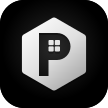

  

# Changelog

Every release is written here, newest first. A version is `MAJOR.MINOR.PATCH`.
Each release before 1.0.0 adds one large function. See "Version numbers" in
the decisions.

A tag such as `v0.1.0` builds the unsigned IPA and attaches it to a release on
GitHub as `Polytechnium.ipa`.

## 0.5.0 (2026-10-22)

- Adds the Exams screen. Each exam has its course, its date and time, its
  room, and a note. The screen shows the days that are left to each exam.
- Reminds you at 18:00 one week, three days, and one day before an exam.
  The reminder of an exam can be off.
- The course of an exam comes from the timetable and the grades, or you
  write it.

## 0.4.0 (2026-10-22)

- Adds the Grades screen. Each course has its credits and the parts of its
  grade, such as the midterm, the labs, and the final, each with its weight.
- Shows the average of the passed courses, weighted by their credits, on
  the scale from 4 to 10.
- The what-if mode gives the points that a part needs for a grade, such as
  "You need 65 points on Final exam" for an 8.
- Adds the courses of the timetable to the grades with one tap. Two forms
  of the name of one course, such as "Analiza" and "Analize Numerike",
  give one course.
- A number pad has a Done button.

## 0.3.0 (2026-10-22)

- Adds the Next class widget for the home screen and the lock screen. It
  shows the class that is on, or the next class, with the room and the time.
  The medium size also shows the class after it.
- The widget changes at the start and the end of each class.
- The data file moves into the folder of the app group, which the app and
  the widget share.

## 0.2.0 (2026-10-22)

- Adds the Today screen. It shows the class that is on now, with the room,
  the lecturer, the kind, and the time that is left.
- Today also shows the next class, when it starts, and the other classes of
  the day. After the last class, the next class can be on another day.

## 0.1.0 (2026-10-22)

- The first version of Polytechnium for iPhone and iPad.
- Imports the timetable PDF of the Faculty of Information Technology. The app
  finds each group, such as II-A-ELN, and keeps the classes of the group that
  you choose. A lecture for many groups goes to each of them.
- Shows the classes of each day with the hours, the kind (lecture, seminar,
  or lab), the room, and the lecturer.
- Reads the odd weeks (tek) and the even weeks (cift). A class that is not on
  this week shows grey.
- Adds, changes, and deletes a class.
- The text is in English and in Albanian. The app uses the language of the
  device, or the language that you choose in Settings.
